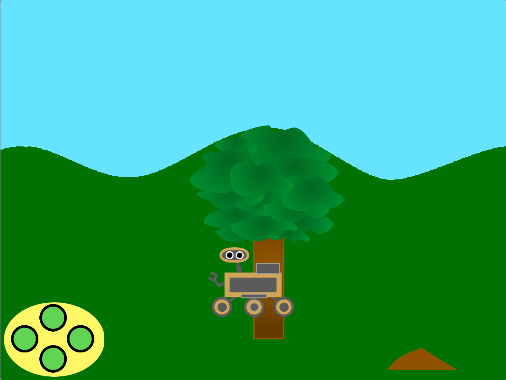

## Lo que harás

Crea un escenario salvaje para que un vehículo explorador de naturaleza la recorra.

**Vehículos exploradores** son robots. ¡Se pueden utilizar para realizar experimentos científicos en lugares remotos, como Marte!  Examinan su entorno y pueden orientarse hacia características interesantes y tomar muestras. Si funcionan con energía solar, pueden colocarse en un lugar soleado para recargar sus baterías.

Vas a:
+ Mueve objetos usando la perspectiva para dar la apariencia de distancia
+ Organiza cambios de disfraz con `mis bloques`{:class='block3myblocks'}
+ Crea una escena realista usando desplazamiento

**Desplazamiento** es cuando los gráficos (u objetos en la escena) se mueven hacia la izquierda, derecha, arriba o abajo en la pantalla de un computador. El desplazamiento hace que las escenas se vean más realistas.

--- no-print ---

### Reproducir ▶️

--- task ---

  
¿Qué sucede cuando haces clic en los botones para mover el vehículo explorador? ¿Cómo describirías cómo se desplaza el fondo/los sprites (cómo se mueven)?

Intenta recolectar una muestra moviendo el vehículo explorador hasta que toque la fruta o la tierra y luego haciendo clic en el vehículo explorador.

  <iframe allowtransparency="true" width="485" height="402" src="https://scratch.mit.edu/projects/embed/551066826/?autostart=false" frameborder="0"></iframe>

--- /task --- --- /no-print ---

--- print-only ---

--- /print-only ---
